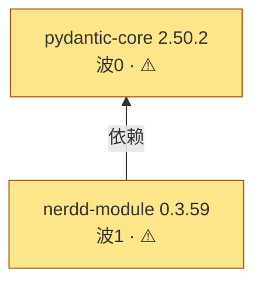

# 迁移汇总报告（final-report）

- 根库（目标库）：`nerdd-module`
- 工作区：`/storage/Users/currentUser/cache/nerdd-module-20261102-093341`
- 验证模式：`shell` · auto_mode：`True`
- 迁移完成（migration_finished）：`True`
- 更新时间：2026-11-02T03:21:24Z

## 依赖编排图

## 规模摘要

| 状态 | 数量 |
|---|---|
| ✅ 成功(done/pass) | 0 |
| ⚠️ 条件通过(done/conditional_pass) | 2 |
| ⬇️ CNB 版本降级(done/迁移未通过) | 0 |
| 🚫 未经流程校验(ungated) | 0 |
| ⛔ 阻塞点·待决策(blocked) | 0 |
| 🚫 根库必选依赖不可用(dep_failed) | 0 |
| 🛑 人工放弃(give-up) | 0 |
| 🔼 已判断需full（运行期仅记账；KB命中仍阻塞） | 0 |
| ⌛ 未开始(pending) | 0 |
| 合计 | 2 |

## ✅ 成功

_(无)_

## ⚠️ 条件通过（测试部分通过）

- `pydantic-core==2.50.2` · conditional_pass · 原因: verification 框架 pass 门槛要求 passed==total；实测 5977/6173 通过（119 测试文件全 passed，0 failed/0 error/0 crashed），196 skipped 全为上游 skipif/xfail 主动跳过（0 迁移回归），分类 L1。196 个上游预期 skip 无法转为 passed，故稳态 conditional_pass。 · 产物: /storage/Users/currentUser/cache/nerdd-module-20261102-093341/pydantic-core/harmony-migration-lite/execute/pydantic_core-2.50.2-cp312-cp312-ohos_aarch64.whl
- `nerdd-module==0.3.59` · conditional_pass · 原因: 65/66 用例通过，provenance verified=true；唯一失败 tests/basic/input/test_read_inchi_file.py::test_read_inchi_file（期望 5 条结果实得 1 条），根因为依赖原生库 rdkit 的 MolFromInchi 在 HarmonyOS 上对带末尾换行的 bytes 输入返回 None（stripped_str 可解析），归类 TC-0110 原生 ABI 不兼容，is_library_defect=no、impact_scope=optional，非本库纯 Python 代码缺陷 · 产物: —

## ⛔ 阻塞点（待决策：补源 / 降级 / 裁剪 / 放弃）

_(无)_

## 🚫 根库必选依赖不可用（整批已收尾）

_(无)_

## 🛑 人工放弃（give-up 决策，不再派发）

_(无)_

## 🔼 已判断需 full（已记账；运行期判断不阻塞）

_(无)_

## ⬇ CNB 版本降级（迁移未通过，改用 CNB 现有版本）

_(无)_

## 🧪 测试依赖未迁出（**不影响 verdict**，仅影响测试覆盖）

_(无)_

## ⚠️ 源码未经取源链（外部提供，版本未验证）

_(无)_

## 🚫 未经流程校验（声明 pass 但无 orchestrator 背书，须返工真跑）

_(无)_

<!-- MIGBOT_TIME_START -->

## 各阶段用时（按库归因）

> 状态：已完成 · 2 个单元（pending 不计） · 更新于 2026-11-02T03:21:24Z

| 库 | 外层分析器 | 调度器 | 编排器 | analysis | design | plan | execution | verification | 合计 |
|---|---|---|---|---|---|---|---|---|---|
| `pydantic-core==2.50.2` | 11s | 1m0s | 13m57s | 2m56s | 36s | — | 2m45s | 19m26s·×2 | 40m51s |
| `nerdd-module==0.3.59` | 6s | — | 19m4s | 9m2s | 20s | — | 9m31s | 15m35s·×2 | 53m38s |
| 全批共用 | 3m47s | — | — | — | — | — | — | — | 3m47s |
| **合计** | **4m4s** | **1m0s** | **33m1s** | **11m58s** | **56s** | **—** | **12m16s** | **35m1s** | **98m16s** |
| 其中 agent 开销 | — | — | — | — | — | — | — | — | 41m1s |
| 实际总耗时（从开始到结束） | — | — | — | — | — | — | — | — | 101m49s |
| 未计时 | — | — | — | — | — | — | — | — | 3m33s |

> **列的意思**：外层分析器=阶段 P 摸图时该库那个节点花掉的时间（so 单元不走摸图故为 `—`）；调度器=补源下载 + 派发/回填命令；编排器=orchestrator 自己（init / mark-stage 门禁校验 / 收尾）；阶段列=该阶段从开始到结束的时间（**含 agent 思考和 subagent 启动**）；`·×N`=该阶段被门禁打回、含返工共跑 N 次。
> **末尾几行的意思**（合起来正好等于实际总耗时）：
> - **全批共用** = 测到了、但落不到表里任何一行的时间：整批只跑一次的活（建图 SCC/排 wave），**以及闭包里那些不是迁移单元的节点**（已被 CNB 封口的、纯 Python 依赖等——它们要摸图但不用迁移，所以没有自己的行）。刻意**不平摊到各库**——摊了会让同一个库在不同批次里数字不一样。
> - **并发重叠（扣减）** = 摸图是多线程并行的，各库时间加起来会超过真实流逝的时间，这一行把多算的部分减回去（所以是负数）。
> - **未计时** = 压根没被计时器盖住的时间：库与库之间的等待、agent 在两条命令之间的空档、**以及被超时杀掉的进程还没来得及落盘的那段**（进程被 kill 时 Python 不跑 finally，该阶段的明细就没了，但这段时间照样计在总耗时里）。它明显偏大时，先怀疑有库被超时打断。
> 机器可读的同一份数据：`.scheduler/time-report.json`（本表由它渲染）。

<!-- MIGBOT_TIME_END -->

## 目标库结论

目标库 `nerdd-module`：⚠️ conditional pass
