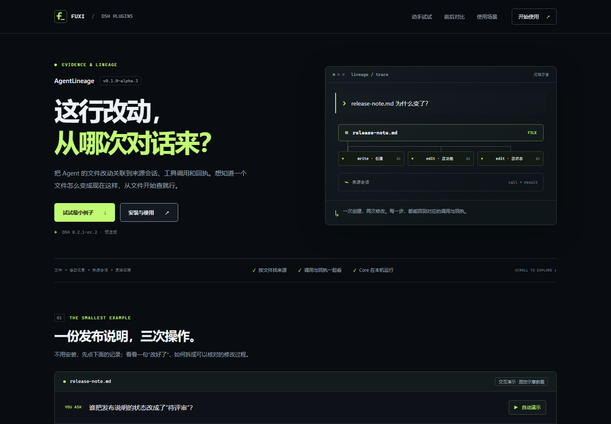
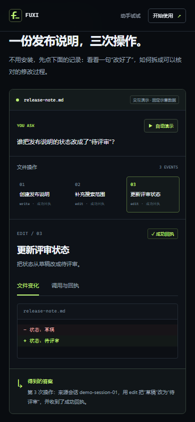

# 插件介绍页模板 · AgentLineage 实例

会议评审入口。统一深色模板已经套用到 AgentLineage；下面是浏览器实际渲染的截图。

后续更新：介绍页已补充约 52 秒的[真实 DSH 操作视频](https://fuxi-ailabs.github.io/dsh-plugin-market/plugins/agentlineage/#recording)，使用同一个发布说明最小例子。[录制说明与证据](../demos/agentlineage-recording.md)。

## 本次要确认什么

1. 首屏是否足够快地讲清“做什么”：从文件改动回到来源会话、工具调用和回执。
2. 最小例子是否直观：谁把 `release-note.md` 从“草稿”改成“待评审”？点击三次操作、查看 diff 和对应引用。
3. Before / After、三个使用场景和五步使用，是否能帮助新用户开始。
4. 近黑底色、荧光绿、等宽标注的视觉方向，是否作为后续插件的统一模板。

## 统一的六段结构

| 页面位置 | 回答的问题 | AgentLineage 实例 |
|---|---|---|
| Overview | 它做什么？ | 这行改动，从哪次对话来？ |
| 最小例子 | 能先看一个具体例子吗？ | 发布说明：一次 write、两次 edit，点选过程和证据 |
| Before / After | 带来什么变化？ | 逐条翻会话 → 按文件看来源，附既有运行截图 |
| Use cases | 我什么时候会用？ | 代码审查、历史任务复盘、报告证据核对 |
| 五步使用 | 怎么开始？ | 准备 Core → 安装 → 就绪检查 → 最小实验 → Viewer |
| 使用条件 | 使用时需要知道什么？ | 冻结快照需要刷新、观测范围、结论判断 |

## 看完整效果

- [桌面完整长图](assets/agentlineage-desktop.png)
- [手机完整长图](assets/agentlineage-mobile.png)
- [手机首屏](assets/agentlineage-mobile-hero.png)
- [手机交互例子](assets/agentlineage-mobile-demo.png)

## 模板、内容和材料

- [模板说明与复用方法](../plugin-page-template.md)
- [新插件内容骨架](../../templates/plugin-page/content.example.json)
- [AgentLineage 页面内容](../../content/plugins/agentlineage.json)
- [AgentLineage 材料、文档依据与真实录屏分镜](../agentlineage-page-materials.md)
- [生成后的页面 HTML](../../public/plugins/agentlineage/index.html)

其他插件填写内容 JSON，复用同一个 HTML 生成器、CSS 和交互脚本。生成结果一致性纳入 CI，每个索引插件都需要指向已登记的介绍页。

## 交互预览

GitHub 中直接看这份文档和截图。要操作页面，可以检出本 PR 分支后运行 `npm run preview`，打开 `http://127.0.0.1:4173/plugins/agentlineage/`；也可以直接用浏览器打开 `public/plugins/agentlineage/index.html`，页面不依赖远端接口。

这个 PR 尚未合入时，现有 GitHub Pages 地址仍是旧页面；合入后才会由仓库原有工作流发布新交互页面。截图与页面源码都随本 PR 提交。

## 验证与评审结果

- `npm run ci`：生成结果一致性、官方市场索引解析、发布资源与文档链接清单、DSH 兼容性/来源策略均通过。
- 浏览器：12 项检查通过；360 / 390 / 768 / 1024 / 1440 px 无横向溢出；无脚本异常或失败的页面资源。
- 交互：三次操作与对应引用、diff/证据 Tabs、方向键/Home/End、两张截图放大与 Escape/焦点恢复、复制成功与手动回退、自动演示完成及手动中断、折叠说明均通过。
- 关闭 JavaScript 后仍能阅读定位、例子答案和五步使用；交互控件需要 JavaScript。
- 独立代理静态评审已完成：修复通用模板中溯源专属状态文案和可选视频尺寸约束两项建议。独立代理评审不等同于 GitHub 维护者 approval。

模板初版的交互例子是明确标注的固定示意数据，Before / After 使用仓库既有截图。后续已独立完成真实 DSH 任务并补录操作视频；其运行与剪辑边界见上方录制说明。
